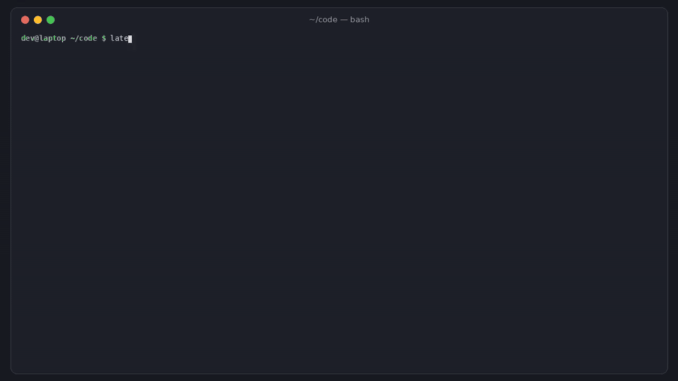

# latestshift

[](https://github.com/hamarshehmhmd/latestshift/actions/workflows/ci.yml)


[](LICENSE)



**Your CI went red and nobody touched it.** GitHub is moving `ubuntu-latest` from Ubuntu 24.04 to
Ubuntu 26.04, rolling out from October 19 and finishing by November 19, 2026
([actions/runner-images#14748](https://github.com/actions/runner-images/issues/14748), 260+ reactions,
130+ comments). Until then the same job can land on 24.04 one run and 26.04 the next, so a re-run that
passes proves nothing. On 26.04 there is no Python 3.8/3.9, the default JDK is 25, `sudo` is sudo-rs,
there is no Miniconda, some apt packages are gone, Docker is 29, glibc is 2.43, and so on.

`latestshift` answers three questions:

| | command | needs |
|---|---|---|
| Which of my jobs will break on 26.04, and where? | `latestshift scan` | nothing (offline) |
| Is this red job my code, or the new image? | `latestshift runs OWNER/REPO` | a GitHub token |
| How do I stop the bleeding today? | `latestshift pin --write` | nothing |

## Install

```sh
curl -fsSL https://raw.githubusercontent.com/hamarshehmhmd/latestshift/main/install.sh | sh
```

Uses `uv tool`, then `pipx`, then a private venv in `~/.local/share/latestshift`. Python 3.9+, one
dependency (PyYAML). Or: `pipx install git+https://github.com/hamarshehmhmd/latestshift`.

## Usage

### `scan`: what will break (offline)

```console
$ latestshift scan            # in a repo; or: latestshift scan path/to/repo
latestshift: 1 workflow file(s), 5 job(s)
  4 job(s) on ubuntu-latest (moving to Ubuntu 26.04 by Nov 19, 2026), 1 pinned to an explicit ubuntu-XX.04

BREAK .github/workflows/ci.yml:17  job test  [py-old]
       matrix: os=ubuntu-latest, python=3.9
       setup-python python-version 3.9: no Python 3.9 build exists for Ubuntu 26.04 ("The version '3.9' with architecture 'x64' was not found for Ubuntu 26.04")
       fix: run this version on ubuntu-24.04 (matrix include with os: ubuntu-24.04), or drop 3.9
BREAK .github/workflows/ci.yml:27  job e2e  [playwright-old]
       @playwright/test ^1.55.0 (package.json): Playwright before 1.61 cannot install browsers on 26.04 ("does not support chromium on ubuntu26.04-x64")
       fix: update to @playwright/test >= 1.61
BREAK .github/workflows/ci.yml:36  job android  [java25-gradle]
       default JDK is 25 on 26.04 (17 on 24.04); Gradle wrapper 8.10.2 cannot run on Java 25 before 9.1 ("Unsupported class file major version 69")
       fix: add actions/setup-java with java-version: '17' (or 21), or move the wrapper to Gradle >= 9.1
...
6 break, 1 risk, 0 info   quick way out: latestshift pin --write  (ubuntu-latest -> ubuntu-24.04)
```

(That is [`examples/webapp`](examples/webapp).) What it understands:

- **Matrices.** Expands `strategy.matrix` with GitHub's `include`/`exclude` rules and substitutes
  `${{ matrix.* }}`, so `python: ["3.9", "3.12"]` on `ubuntu-latest` is flagged, but an `include` that
  pins 3.9 to `ubuntu-24.04` is not. Matrices built with `fromJSON(...)` are reported as unresolved.
- **Only jobs that move.** Jobs already on `ubuntu-24.04`/`22.04`, Windows, macOS or self-hosted are
  skipped. `--include-26` also checks jobs you've already moved to `ubuntu-26.04`.
- **Repo files.** `.python-version`, `.ruby-version`, `package.json` (Playwright, WebdriverIO) and the
  Gradle wrapper version.
- **Container jobs.** When a job sets `container:`, steps run in that image, so userland rules (Python
  builds, apt, sudo) are skipped and only host-level ones (kernel, Docker, AppArmor) apply.

Exit code is 1 when a finding is at least `--fail-on` (default `break`), else 0. Formats:
`--format text|json|markdown|github` (`github` prints `::error file=...,line=...` annotations).
`--min-severity info` shows info-level notes too (e.g. GCC 15 compiling C as C23).

### `runs`: is it my code or the image?

```console
$ latestshift runs acme/shop
latestshift runs acme/shop: 5 recent run(s), 20 job log(s) read
  CI / build  24.04: 4 pass 0 fail  26.04: 0 pass 2 fail   FAILS ONLY ON 26.04
      red on 26.04 (20261101.186.1): https://github.com/acme/shop/actions/runs/104/job/9014
      green on 24.04 (20261025.353.1): https://github.com/acme/shop/actions/runs/105/job/9018
      run 103: failed on 26.04, re-run passed on 24.04 (the re-run proves nothing)
  CI / lint   24.04: 1 pass 0 fail  26.04: 4 pass 0 fail   ok on 26.04
  CI / e2e    24.04: 2 pass 1 fail  26.04: 0 pass 2 fail   fails on both
  CI / docs   24.04: 4 pass 0 fail                         not on 26.04 yet
1 job(s) look broken by the image, not your code. Pin them (latestshift pin) or fix with latestshift scan.
```

(That output is from the recorded example in `tests/fixtures/cassette.json`, with made-up names.) It
lists recent completed runs, takes every `ubuntu-latest` job (all attempts, so re-runs count), reads
the first 96 KB of each job log, and parses the "Runner Image" block from "Set up job". Then it tallies
pass/fail per job name per image. GitHub only serves job logs to signed-in requests, so it uses
`GH_TOKEN`/`GITHUB_TOKEN` or `gh auth token`. Logs expire after 90 days by default. Options:
`--limit` runs, `--max-logs`, `--branch`, `--workflow ci.yml`, `--all-labels`, `-v` (every job run),
`--format json`, `--fail-on-suspect`.

### `pin`: stop the bleeding

```console
$ latestshift pin            # dry run: prints a diff
$ latestshift pin --write    # ubuntu-latest -> ubuntu-24.04 in every workflow file
$ latestshift pin --to ubuntu-26.04 --file ci.yml --write   # move one workflow on purpose
```

It replaces the `ubuntu-latest` token everywhere in workflow YAML (including `matrix.os == 'ubuntu-latest'`
conditions) but not in comments. Pinning buys time; 24.04 is supported for a long while, but you will
want to fix what `scan` found and move on purpose.

### GitHub Action

```yaml
- uses: actions/checkout@v5
- uses: hamarshehmhmd/latestshift@v0.1.0
  with:
    fail-on: break        # break | risk | info | none
    # min-severity: risk
    # include-26: "true"
```

Adds annotations on the workflow lines and a table to the job summary.

## Rules

Each rule cites where the breakage was reported. `break` = the documented failure happens as written;
`risk` = it depends on things latestshift can't see; `info` = changed behaviour.

| rule | severity | what |
|---|---|---|
| `py-old` | break | `setup-python` 3.7/3.8/3.9 (inputs, matrices, `.python-version`): no 26.04 builds ([manifest](https://github.com/actions/python-versions/blob/main/versions-manifest.json)) |
| `py-patch` | break | exact patch pins older than the 26.04 builds (e.g. 3.12.4; 26.04 has 3.12.13+) |
| `java25-gradle` | break | `./gradlew`/`flutter build apk` with no `setup-java` and a Gradle wrapper < 9.1: default JDK is 25 ([image readme](https://github.com/actions/runner-images/blob/main/images/ubuntu/Ubuntu2604-Readme.md)) |
| `java8-home` | break | `JAVA_HOME_8_X64` is unset on 26.04 |
| `sudo-E` | break | `sudo -E` / bare `--preserve-env`: sudo is sudo-rs |
| `conda` | break | `$CONDA` / `conda` without setup-miniconda: no Miniconda on the image |
| `apt-gone` | break | `apt-get install` of packages missing on 26.04 (`libpcre3-dev`, `qemu-user-static`, `gcc-10`, `clang-format-14`, ...) |
| `apt-modules-extra` | break | `linux-modules-extra-*` doesn't exist for the 7.0 azure kernel |
| `ppa-ondrej`, `llvm-apt` | break/risk | PPAs/apt repos with no `resolute` builds (ondrej/php; apt.llvm.org clang 17-20) |
| `golangci-v1` | break | golangci-lint v1 under 26.04's default Go 1.26 ([#15179](https://github.com/actions/runner-images/issues/15179)) |
| `bwrap` | break | bubblewrap blocked by AppArmor's `bwrap-userns-restrict` |
| `bandit-action`, `setup-swift-v2`, `setup-beam-old`, `otp-old`, `ruby-patch`, `julia-execstack`, `crystal-pcre` | break | action versions / language versions with no 26.04 support |
| `playwright-old`, `wdio-xvfb` | break | Playwright < 1.61, WebdriverIO 9 < 9.33.1 (from `package.json`) |
| `wireguard` | break | `wg-quick up ./file.conf` blocked by AppArmor |
| `podman-pasta` | risk | rootless Podman teardown ([#15182](https://github.com/actions/runner-images/issues/15182)) |
| `mongo-kernel7`, `ansible-test` | risk | known failures on the 7.0 azure kernel (also on current 24.04 images) |
| `pg-dump-18` | risk | image `pg_dump` 18 against an older Postgres service |
| `cache-image-key` | risk | caches of `ms-playwright`/venvs whose key doesn't name the image (`ImageOS`) |
| `glibc-floor` | risk | release binaries built on 26.04 need glibc 2.43 |
| `rpm6`, `kind-load`, `free-disk-space` | risk | rpm 6, Docker 29 containerd store, free-disk-space `large-packages` |
| `gcc15` | info | GCC 15 compiles C as C23 by default |

Most entries come from the [migration issue](https://github.com/actions/runner-images/issues/14748), the
issues it links, the 26.04 image readme, and [Lesstep's running list of 26.04
breakages](https://lesstep.com/github-actions/ubuntu-latest-26-04/). CI checks the core ones
against the real image: the `verify-rules-on-2604` job runs on `ubuntu-26.04` and asserts that
setup-python 3.9 and 3.12.4 fail, the default JDK is 25, `JAVA_HOME_8_X64` and `CONDA` are empty, and
`libpcre3-dev`/`qemu-user-static` can't be installed.

## Limits

- `scan` reads workflow files, not your build. A clean scan is not a guarantee: the real test is a
  branch with `runs-on: ubuntu-26.04`.
- It doesn't follow reusable workflows or composite actions in other repos, and can't expand
  `fromJSON` matrices; it says so in `-v` notes.
- The rule list is a snapshot from November 9, 2026. The image keeps changing (e.g. the `/tmp` quota
  was fixed in late-October images), so some findings may go stale. Issues and PRs welcome.
- `runs` needs logs that still exist (90 days by default) and reads one log per job, so `--max-logs`
  caps API use.

## Demo

[`demo.mp4`](https://github.com/hamarshehmhmd/latestshift/releases/download/v0.1.0/demo.mp4) is a
2.7-minute narrated walkthrough (attached to the v0.1.0 release). `demo/render.py` rebuilds it from
real command output.

## Development

```sh
python -m venv .venv && . .venv/bin/activate
pip install -e . pytest
pytest -q
```

## License

GNU Affero General Public License v3.0 or later ([LICENSE](LICENSE)), SPDX `AGPL-3.0-or-later`.

Commercial licenses without the AGPL obligations are available from the author: contact
[Mohammad Hamarsheh](https://github.com/hamarshehmhmd).
